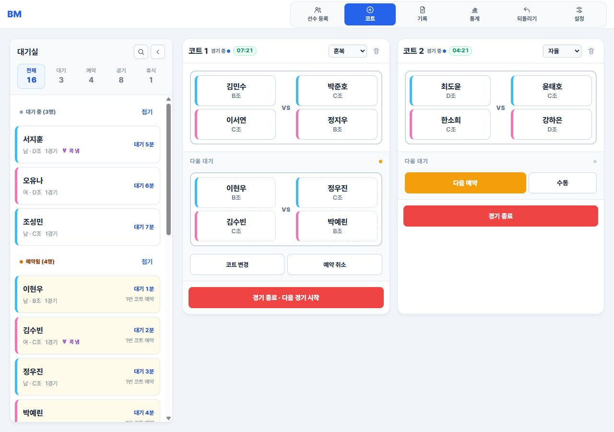
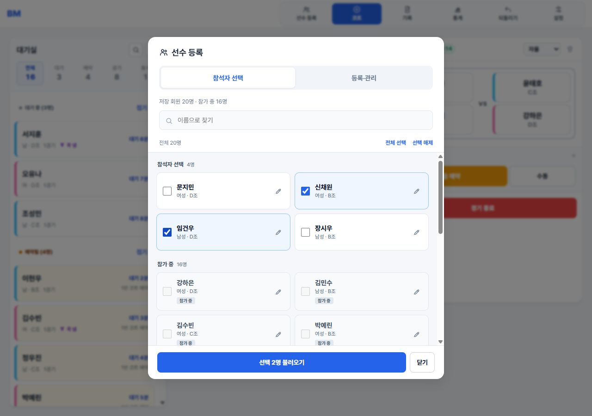
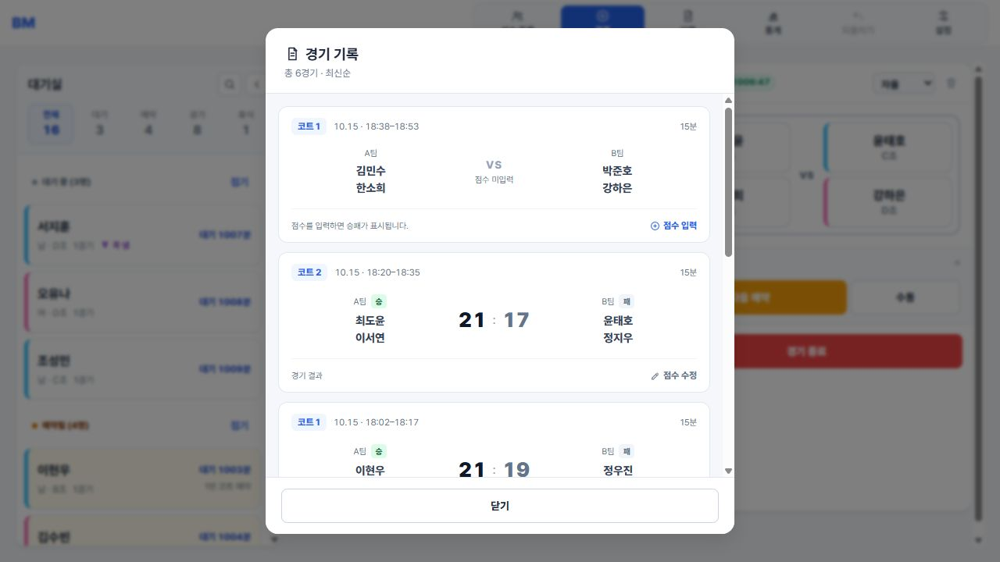
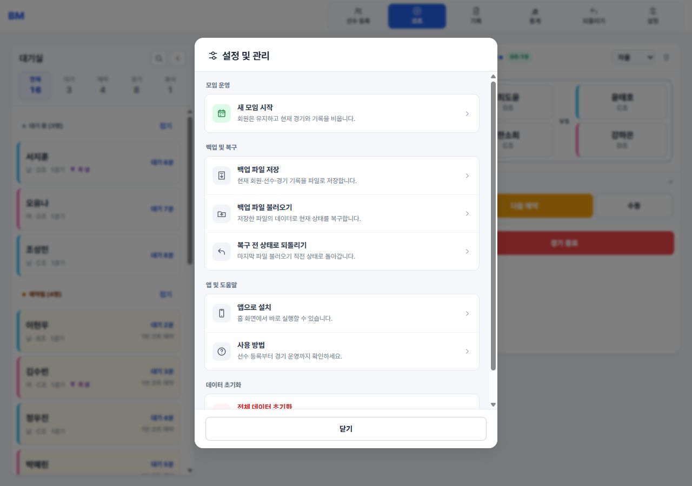

# 🏸 Badminton Manager

배드민턴 동호회와 소규모 모임에서 선수 대기열, 코트 배정, 자동 매칭, 경기 기록을 한 화면에서 관리하는 설치형 웹 앱(PWA)입니다.

별도의 회원가입이나 앱스토어 등록 없이 브라우저에서 바로 실행할 수 있으며, Android와 iPhone/iPad의 홈 화면에 앱처럼 설치할 수 있습니다.

**[웹 앱 실행하기](https://whcksdud.github.io/Badmintonmanage/)**



현재 UI를 예시 데이터로 촬영한 화면입니다. 실제 모임의 회원 정보는 포함하지 않았습니다.

| 참석자 선택 | 경기 기록 | 설정 및 관리 |
| --- | --- | --- |
| [](./docs/screenshots/attendee-selection.jpg) | [](./docs/screenshots/match-history.jpg) | [](./docs/screenshots/settings.jpg) |

이미지를 누르면 크게 볼 수 있습니다.

> [!IMPORTANT]
> 현재 데이터는 사용하는 기기와 브라우저의 `LocalStorage`에만 저장됩니다. 다른 사용자나 다른 기기로 실시간 공유되지 않습니다. 실시간 현황판은 [BACKLOG.md](./BACKLOG.md)에 별도 계획으로 남겨두었습니다.

## 주요 기능

| 구분 | 기능 |
| --- | --- |
| 회원 명단 | 이름·성별·급수 개별·일괄 저장, 현재 선수 명단 저장, 검색·선택 후 대기실로 불러오기, 회원 수정·삭제, QR 공유 |
| 선수 관리 | 개별·일괄 등록, 이름 검색, 성별 구분선, 급수·게임 수 관리, 펼침형 휴식·콕·정보 수정 동작 |
| 코트 운영 | 코트 추가·삭제, 자율·남복·여복·혼복 설정, 진행·다음 경기의 VS 팀 구분 |
| 매칭 | 매칭용 경기 수와 대기 시간에 따른 선발, 같은 4명·동반 출전 반복 완화, 혼복 팀 급수 균형, 4명 수동 매칭 |
| 현장 대응 | 코트 안 팀 변경·선수 교체, 다음 경기 예약 취소·코트 변경, 경기 종료 후 자동 승계 |
| 기록·통계 | 경기 시작·종료 시각과 점수·승패 기록, 전체 출전·조합 순위와 선수별 경기 관계 통계 |
| 데이터 관리 | JSON 백업·복구, 저장된 회원에서 참석자를 다시 선택하는 새 모임 시작, 전체 초기화 |
| 앱 기능 | Android·iOS 홈 화면 설치, 독립 실행 화면, 기본 오프라인 실행 |

## 기본 사용 순서

1. 상단 `선수 등록 → 참석자 선택`에서 저장된 회원을 불러오거나, `등록·관리` 탭의 `+ 개별` 또는 `+ 일괄`로 당일 선수를 등록합니다. 모바일에서도 상단 `선수 등록`을 누릅니다.
2. 대기 중이거나 예약된 선수 카드에서 `대기 3분`처럼 대기 시간을 확인합니다. 필요한 선수는 `휴식`으로 바꿔 자동 매칭 대상에서 제외합니다.
3. 상단의 `코트` 버튼을 눌러 실제 사용 중인 코트 수만큼 추가합니다.
4. 각 코트의 `자동 매칭`·`다음 예약` 버튼 오른쪽에 표시된 경기 유형을 누르고 `자율`, `남복`, `여복`, `혼복` 중 하나를 고릅니다. 목록은 버튼 위에 열리며, 유형 선택만으로는 예약하지 않습니다. 왼쪽 실행 버튼을 누르면 선택한 유형으로 예약합니다.
5. `자동 매칭` 또는 `수동`을 눌러 4명을 배정합니다. 빈 코트는 배정 내용을 확인한 뒤 `경기 시작 · 선수 입장`을 눌러 시작합니다. 수동 배정만으로 타이머나 경기 기록은 시작되지 않습니다.
6. 진행 중인 경기에서 `경기 종료` 또는 `경기 종료 · 다음 경기 시작`을 누르면 기록이 저장되고, 시작할 수 있는 다음 예약이 있으면 자동으로 승계됩니다. 점수는 상단의 `기록`에서 해당 경기의 `점수 입력`을 눌러 기록합니다.
7. 상단의 `통계`에서 전체 출전 현황을 보거나, 선수별 통계 탭에서 누구와 몇 경기 했는지 확인할 수 있습니다.
8. 모임 종료 후 `설정 → 백업 파일 저장`으로 JSON 파일을 보관합니다.

### 경기 중 편성 변경

- **팀 변경:** 코트 안 선수 이름을 누르고 `팀 변경`에서 상대 팀 선수를 선택하면 두 선수의 자리가 바뀝니다. 진행 경기와 다음 대기에 모두 적용되며, 혼복 코트에서는 같은 성별끼리 변경할 수 있습니다.
- **선수 교체:** 같은 창의 `선수 교체`에서 새로 투입할 선수를 선택합니다. 다음 대기의 교체에서는 현재 다른 코트에서 경기 중인 선수도 선택할 수 있습니다.
- **예약 코트 변경:** 다음 대기 아래의 `코트 변경`에서 대상 코트를 선택합니다. 대상에 예약이 있으면 두 코트의 다음 경기가 서로 이동합니다. 진행 중인 경기와 타이머는 유지됩니다.
- **작업 취소:** 상단 `되돌리기`로 가장 최근의 데이터 변경 한 단계를 복원합니다.

## 회원을 저장하고 모임마다 불러오기

1. 상단 `선수 등록`을 엽니다. 기본 화면은 검색·선택에 집중한 `참석자 선택` 탭이며, 저장 회원 수와 참가 중인 회원 수를 확인할 수 있습니다.
2. `등록·관리 → + 회원 등록`에서 이름·성별·급수를 저장합니다. 같은 성별·급수의 여러 회원은 이름을 줄바꿈으로 구분해 한 번에 등록할 수 있습니다. 이미 대기실에 선수를 등록했다면 `현재 선수 명단 저장`을 누릅니다. 등록 후 참석자 선택 화면으로 돌아갑니다.
3. `참석자 선택` 목록에서 회원을 선택하고 하단의 `선택 N명 불러오기`를 누릅니다. 선택된 카드는 파란색으로 표시되고, 이미 참가 중인 회원은 별도 목록에 표시되어 중복으로 불러오지 않습니다. 이름 검색과 검색 결과 `전체 선택`을 사용할 수 있으며, 탭을 이동하거나 검색어를 바꿔도 선택은 유지됩니다. 이름 옆 연필 아이콘으로 회원 정보 수정과 명단 삭제를 할 수 있습니다.
4. 다음 모임에서는 `설정 → 새 모임 시작`을 사용합니다. 저장된 회원은 유지하고 당일 선수·경기 기록·코트 배정을 비운 뒤 참석자를 다시 고릅니다. 초기화 전에 필요한 경기 기록은 백업하세요.

회원에는 이름·성별·급수만 저장합니다. 불러온 선수는 실제 경기 수 0, 셔틀콕 미제출, 대기 상태로 시작하고, 도중 참가 시 기존 신규 선수와 같은 매칭 보정을 적용합니다. 연결된 회원과 선수의 이름·성별·급수 수정은 서로 반영됩니다. 회원을 삭제해도 현재 모임의 선수와 경기 기록은 유지됩니다.

같은 이름·성별·급수의 중복 등록은 제외합니다. 동명이인은 이름에 구분을 추가하세요. 회원 명단은 같은 기기·브라우저에 저장되며 JSON 백업·복구와 최근 작업 되돌리기에 포함됩니다. 회원 명단이 없는 이전 버전 백업을 복구하면 현재 저장된 회원은 유지합니다. `전체 데이터 초기화`는 회원 명단도 삭제합니다.

### 다른 기기로 회원명단 공유

1. 보내는 기기에서 `선수 등록 → 등록·관리 → 명단 공유`를 열고 `코드 복사`를 누릅니다. `BM2-`로 시작하는 코드 하나에 저장된 회원 전체의 이름·성별·급수를 담습니다. 당일 선수·출석·경기 기록은 포함하지 않습니다.
2. 코드를 상대에게 보내고, 받는 기기의 `선수 등록 → 등록·관리 → 코드 불러오기`에 전체를 붙여 넣습니다. 줄바꿈과 공백은 자동으로 무시합니다. 새로 추가할 회원과 제외할 중복 수를 확인하고 `회원 N명 추가`를 누릅니다. 이전에 받은 공유 링크도 이 화면에서 읽을 수 있습니다.
3. 받는 기기의 기존 회원·현재 경기·기록은 유지합니다. 이름의 앞뒤 공백을 제외하고 이름·성별·급수가 모두 같은 회원은 중복으로 제외합니다. 같은 코드를 다시 가져와도 중복 추가되지 않습니다. 추가는 상단 `되돌리기`로 취소할 수 있습니다.
4. 공유 창의 `가까이 있다면 QR로 보내기`에 QR이 바로 표시됩니다. **오늘 참석자뿐 아니라 저장된 전체 회원명단**을 압축해, 들어갈 수 있으면 한 장으로 보냅니다. 가까이 있는 휴대폰 카메라나 설치된 웹앱의 QR 스캔으로 읽어 주세요. 용량을 넘으면 여러 장으로 나뉘며, `이전`·`다음`으로 이동해 모든 QR을 차례로 읽어야 전체 회원이 추가됩니다. 각 QR은 따로 추가할 수 있고 이전 QR 링크도 계속 읽을 수 있습니다. 코드 복사는 QR 페이지와 관계없이 항상 전체 회원명단을 복사합니다.
5. **설치된 웹앱에 직접 받으려면** 받는 기기의 웹앱을 실행하고 `선수 등록 → 등록·관리 → QR 스캔`을 누릅니다. 카메라를 허용하고 보내는 기기의 QR을 비추면 웹앱 안에서 회원 추가 화면이 열립니다. 일반 카메라로 브라우저를 여는 과정이 없어 웹앱의 기존 명단에 추가할 수 있습니다. 저장된 QR 사진은 `사진에서 읽기`로 선택할 수 있습니다. QR 인식·닫기·앱 전환 시 카메라는 종료되며, 영상과 사진은 업로드하지 않습니다. 카메라는 HTTPS 또는 localhost 환경에서 사용할 수 있습니다.

압축 코드는 브라우저의 [Compression Streams API](https://developer.mozilla.org/en-US/docs/Web/API/Compression_Streams_API)로 JSON을 gzip 압축하고 Base64url로 표현합니다. 서버 업로드나 외부 압축 서비스 없이 기기 안에서 생성·복원하며, 최대 2,000명을 공유할 수 있습니다. 코드 길이는 명단에 따라 늘어나며 암호화된 데이터는 아닙니다. 이 기능을 지원하지 않는 구형 브라우저에서는 업데이트 안내와 함께 QR 공유를 사용할 수 있습니다.

앱이 오프라인으로 저장된 기기에서는 코드 생성·불러오기를 인터넷 없이 사용할 수 있습니다. 처음 앱을 여는 기기는 인터넷 연결이 필요합니다. QR에는 GitHub Pages 앱 주소와 회원 정보가 함께 들어가며, 로컬 개발 중에도 QR은 위의 GitHub Pages 주소를 사용합니다.

QR 생성에는 [qrcode-generator](https://github.com/kazuhikoarase/qrcode-generator)의 MIT 라이선스 코드를 로컬로 포함합니다. 원본 리비전: `64f5976e5f9256348d0f5417ceff934bb43cf279`, 라이선스: [qrcode.LICENSE](./js/vendor/qrcode.LICENSE).

QR 인식에는 [jsQR 1.4.0](https://github.com/cozmo/jsQR)의 Apache-2.0 라이선스 코드를 로컬로 포함합니다. 원본 리비전: `49a9633931fb8030ac2fc9cecc121d6e5a19f9a3`, SHA-256: `bc40c8a15196236b2314db0856f72ca0b49980cd5413b8c852a7349f5fee0859`, 라이선스: [jsQR.LICENSE](./js/vendor/jsQR.LICENSE). 설치 후 오프라인에서도 QR을 읽을 수 있습니다.

## 경기 기록과 통계

상단 `기록`에서는 최근 경기가 먼저 표시됩니다. 각 카드에서 코트 번호, 시작·종료 시각, 경기 시간, 두 팀의 선수를 확인할 수 있습니다. `점수 입력`으로 점수를 저장하면 두 팀 점수와 승패가 표시되고, 이후 `점수 수정`으로 변경할 수 있습니다. 경기 기록은 최대 200개를 보관합니다.

상단 `통계`에서는 전체 출전 현황과 자주 함께한 조합을 확인합니다. 선수별 통계에서는 같은 팀과 상대 팀으로 만난 횟수를 나누어 보여줍니다. 화면의 경기 수는 실제 입력·완료 경기 수를 사용하며, 출전·조합 통계는 보관된 경기 기록을 기준으로 합니다. 매칭 보정값은 포함하지 않습니다.

## 설정 및 도움말

상단 `설정`은 모임 운영, 백업 및 복구, 앱 및 도움말, 데이터 초기화로 나뉩니다. `사용 방법`에는 빠른 시작 안내와 선수 관리·코트 운영·자동 매칭·기록 관리 설명이 있으며, 필요한 항목만 펼쳐 읽을 수 있습니다.

## Android에서 앱으로 설치하기

Chrome 기준 설치 방법입니다. Play 스토어를 이용하지 않습니다.

1. Android 기기에서 **Chrome**을 엽니다.
2. [Badminton Manager](https://whcksdud.github.io/Badmintonmanage/)에 접속합니다.
3. 주소 표시줄 오른쪽의 `⋮` 메뉴를 누릅니다.
4. `설치 및 바로가기 만들기`를 누른 다음 `설치`를 선택합니다.
5. 화면 안내를 완료하면 홈 화면 또는 앱 목록에 **BM** 아이콘이 생성됩니다.
6. 이후 BM 아이콘을 누르면 주소창이 없는 앱 화면으로 실행됩니다.

Chrome 버전에 따라 메뉴가 `앱 설치` 또는 `홈 화면에 추가`로 표시될 수 있습니다. 사이트 안의 `설정 → 앱으로 설치` 버튼을 사용해도 됩니다.

공식 안내: [Google Chrome 웹 앱 사용 방법](https://support.google.com/chrome/answer/9658361?hl=ko&co=GENIE.Platform%3DAndroid)

## iPhone/iPad에서 앱으로 설치하기

Safari 기준 설치 방법입니다. App Store 등록이나 Apple 개발자 계정이 필요하지 않습니다.

1. iPhone 또는 iPad에서 **Safari**를 엽니다.
2. [Badminton Manager](https://whcksdud.github.io/Badmintonmanage/)에 접속합니다.
3. Safari의 `공유` 버튼(사각형 위쪽 화살표)을 누릅니다. 화면 구성에 따라 먼저 `더 보기`를 누른 뒤 `공유`를 선택할 수도 있습니다.
4. 목록을 아래로 내려 `홈 화면에 추가`를 누릅니다.
5. `웹 앱으로 열기`를 켭니다.
6. 오른쪽 위의 `추가`를 누릅니다.
7. 홈 화면의 **BM** 아이콘을 누르면 앱처럼 독립된 화면으로 실행됩니다.

`홈 화면에 추가`가 보이지 않으면 공유 목록 맨 아래의 `동작 편집`에서 해당 항목을 추가하세요. 카카오톡·네이버 등의 앱 내부 브라우저에서는 설치 메뉴가 보이지 않을 수 있으므로 Safari에서 주소를 직접 여는 것을 권장합니다.

공식 안내: [Apple의 iPhone 웹 앱 설치 방법](https://support.apple.com/ko-kr/guide/iphone/iphea86e5236/ios)

## 설치 후 업데이트와 삭제

- 새 버전이 배포되면 앱을 완전히 닫았다가 다시 열거나 화면을 새로고침하세요.
- 이전 화면이 계속 보이면 앱을 다시 열고 인터넷이 연결된 상태에서 한 번 새로고침하세요.
- Android에서는 `설정 → 앱 → BM → 삭제`로 제거할 수 있습니다.
- iPhone/iPad에서는 홈 화면의 BM 아이콘을 길게 눌러 제거할 수 있습니다.
- 앱을 삭제하기 전에는 중요한 데이터를 반드시 JSON으로 백업하세요.

## 데이터 저장과 백업

모든 선수, 코트, 경기 기록은 서버가 아닌 현재 실행 환경의 브라우저 저장소에 보관됩니다.

- 같은 주소라도 기기나 브라우저가 다르면 데이터가 자동으로 공유되지 않습니다.
- Safari, Chrome, 설치된 웹 앱은 운영체제 환경에 따라 저장 공간이 다르게 취급될 수 있습니다.
- 브라우저 사이트 데이터 삭제, 시크릿 모드 종료, 앱 삭제 또는 기기 초기화 시 데이터가 사라질 수 있습니다.
- 기기 변경이나 앱 재설치 전에는 `설정 → 백업 파일 저장`을 실행하세요.
- 복구할 때는 `설정 → 백업 파일 불러오기`에서 저장해둔 JSON 파일을 선택하세요.

## 오프라인 사용

최초 실행과 설치에는 인터넷 연결이 필요합니다. 한 번 정상적으로 실행된 뒤에는 서비스 워커가 기본 화면과 아이콘을 저장하므로 인터넷이 없어도 앱을 다시 열 수 있습니다.

외부 웹폰트나 새 버전 확인에는 네트워크가 필요할 수 있으며, 오프라인 상태에서 입력한 데이터도 현재 기기에만 저장됩니다.

## 매칭 기준

자동 매칭은 다음 순서를 기준으로 동작합니다.

1. **매칭용 경기 수 우선:** 실제 경기 수에 보정값을 더한 매칭용 경기 수가 적은 선수를 먼저 선발합니다. 휴식 복귀 시 다른 활동 중인 선수들(대기·예약·게임 중)의 매칭용 경기 수 평균을 소수점 버림한 값까지 보정합니다. 기존 매칭용 경기 수가 더 높으면 그대로 유지하며, 다른 활동 선수가 없으면 보정하지 않습니다.
2. **동률 대기 보호와 조합 다양성:** 먼저 경기 수만으로 선발할 때의 최소 경기 수 구성을 유지합니다. 그 경계에서 가장 오래 기다린 선수는 반드시 포함하고, 비슷하게 기다린 후보들 사이에서 같은 네 명의 반복과 같은 선수끼리의 동반 출전을 줄입니다. 혼복은 남녀 각각 이 기준을 적용합니다. 나머지 후보의 대기 차이는 기본 16분 또는 해당 코트 직전 경기 시간에 1분을 더한 범위 중 큰 값을 사용합니다. 후보가 한 조뿐이고 경계 경기 수 이하의 후보 안에 두 번 이상 반복된 조가 있으면, 가장 가까운 다음 대기 그룹까지 비교 범위를 확장합니다. 반복 횟수는 최근 100경기와 현재 진행·예약 조합을 기준으로 합니다. 비용이 같으면 더 오래 기다린 조합을, 대기 시각도 같으면 무작위 순서를 우선합니다. 조합을 섞기 위해 일부 선수가 한 차례 더 기다릴 수 있으며 최대 대기 시간을 보장하지는 않습니다.
3. **경기 조합과 파트너 이력:** 선발할 때는 최근 100경기의 동일 4인 조합 횟수, 같은 경기에 함께 출전한 두 선수의 횟수를 순서대로 비교합니다. 같은 팀과 상대 팀 모두 동반 출전에 포함합니다. 선발된 4명의 팀을 나눌 때는 같은 파트너 조합의 반복을 줄이며, 혼복에서는 팀 급수 합 차이가 같을 때 파트너 중복을 비교합니다. 기록 보관 한도는 200경기입니다. 선택 가능한 동률 후보가 없으면 같은 네 명이 다시 선발될 수 있습니다.
4. **팀 밸런싱:** 일반 경기는 급수순으로 만든 3개 조합을 비교하며, 상위 두 명이 같은 팀인 조합에는 페널티 5를 더합니다. 남녀 2명씩 선발된 경우에는 남녀 한 쌍으로 구성한 2개 조합 중 팀 급수 합 차이가 작은 조합을 먼저 선택합니다. 차이가 같으면 최근 100경기의 파트너 중복이 적은 조합을 선택하며, 두 기준도 같으면 첫 번째 조합을 선택합니다. 자동·수동 매칭에 같은 규칙을 적용합니다.
5. **다음 예약 후보:** 자동 예약은 대기 중인 선수만 선발하며, 게임 중이거나 이미 다음 경기에 예약된 선수는 제외합니다. 수동 다음 예약과 다음 대기 선수 교체에서는 게임 중인 선수도 선택할 수 있습니다. 다른 코트에서 아직 경기 중인 선수가 있으면 경기 승계는 보류됩니다.
6. **혼복 구성:** 혼복 코트는 대기 중인 남성 2명과 여성 2명을 각각 매칭용 경기 수가 적은 순으로 선발하며, 동률 후보에서 성별별 최장 대기자를 보호하면서 함께 경기할 네 명을 비교합니다.

예를 들어 실제 1경기를 뛴 선수가 휴식에서 복귀할 때 기준이 5경기라면, 실제 경기 수는 1로 유지하고 보정값 4를 저장합니다. 이후 한 경기를 마치면 실제 2경기·매칭용 6경기가 됩니다. 화면의 경기 수와 경기 기록은 실제 경기 수를 사용하며, 보정값은 재접속과 JSON 백업·복구 시에도 유지됩니다. `새 모임 시작` 시 보정값도 0으로 초기화합니다.

새로 등록하는 선수는 실제 0경기로 시작합니다. 활동 중인 선수들의 매칭용 경기 수 평균을 소수점 버림한 값을 초기 매칭 기준으로 적용합니다. 예를 들어 평균이 5.5이면 실제 0경기·매칭 기준 5경기로 시작합니다. 개별·일괄 등록과 회원 불러오기에 같은 기준을 사용하며, 실제 경기 수를 직접 입력했다면 기준보다 부족한 만큼만 보정합니다. 다른 활동 선수가 없으면 초기 기준은 0입니다. 기존 선수의 실제 경기 수와 보정값은 소급 변경하지 않습니다. 선수 정보 수정에서 실제 경기 수·매칭 기준·보정값을 함께 확인할 수 있습니다.

## 작업 복구와 저장 보호

- 대기 시간은 당일 선수 등록·회원 불러오기 또는 경기 종료·휴식 복귀 시점부터 분 단위로 표시합니다. 예약하거나 예약을 취소해도 시간이 이어지며, 경기 중·휴식 중에는 표시하지 않습니다. 새로고침·백업 복구·되돌리기에도 시작 시각을 유지하며, 자동 선발에서 최장 대기자 보호와 후보 범위 비교에 사용합니다. 화면의 분 표시가 같아도 실제 시작 시각으로 비교합니다. 시작 시각이 없는 이전 데이터는 업데이트 후 처음 열거나 복구한 시점부터 계산합니다.

- 코트는 `비어 있음`, `경기 중`, `시작 가능`, `다른 코트 종료 대기`로 상태를 표시합니다. 시작할 수 없는 예약은 기다리는 선수와 현재 코트를 표시하며, 해당 경기 종료 후 시작 버튼이 활성화됩니다.
- 다음 대기의 `코트 변경`에서 대상 코트를 선택합니다. 대상에 예약이 없으면 이동하고, 예약이 있으면 두 코트의 다음 대기를 서로 옮깁니다. 선수·팀 구성·대기 시각과 진행 중인 경기·타이머는 유지하며, 최근 작업 되돌리기로 복원할 수 있습니다.
- 코트의 선수를 누르면 `팀 변경`에서 상대 팀 선수와 자리를 바꿀 수 있습니다. 현재 경기와 다음 대기에 모두 적용하며, 경기 수·타이머·선수 상태는 유지합니다. 혼복 코트에서는 같은 성별끼리 바꾸고, 최근 작업 되돌리기로 이전 팀을 복원할 수 있습니다.
- 수동 매칭·선수 교체는 이름 검색과 상태 필터 없이 선택 가능한 선수 카드를 바로 표시합니다. 수동 매칭에서 선택한 카드를 다시 누르면 해제되며, 선택 인원은 별도 영역 없이 하단 배정 버튼에서 확인할 수 있습니다.
- 코트의 경기 시작·종료 직후 1초 동안 같은 코트의 재입력을 막아 연속 터치로 다음 경기까지 종료되는 실수를 방지합니다. 다른 코트 조작은 가능하며, 저장 실패 시에는 바로 재시도할 수 있습니다.
- 선수 선택 시 하단 관리 영역에서 실제 경기 수와 매칭 기준을 확인할 수 있습니다. 도움말은 설정 안의 `사용 방법`에서 엽니다.
- 되돌리기 버튼의 도움말과 확인창에 코트·선수 이름을 포함한 최근 작업을 표시합니다. 작업 설명은 재접속 후에도 유지됩니다.

- 상단 `되돌리기`는 최근 데이터 변경 한 단계를 복원합니다. 경기 종료와 승계를 되돌리면 실제 경기 수·경기 기록·진행 선수·다음 예약·원래 시작 시각이 함께 복원됩니다. 재접속 후에도 사용할 수 있으며, 반복해서 여러 단계를 되돌리는 기능은 아닙니다.
- 진행 또는 예약 중인 선수는 교체하거나 예약을 해제한 뒤 삭제할 수 있습니다. 선수 정보 수정은 명단과 코트에 함께 반영됩니다.
- 선수·코트·기록과 직전 상태를 하나의 저장 항목에 함께 기록합니다. 저장에 실패하면 방금 변경을 취소하고 오류를 표시합니다. 기존 v13 저장 데이터는 자동으로 읽으며, 이후 저장부터 새 형식을 사용합니다.
- JSON 복구는 선수 정보, ID 중복, 코트 배정 관계와 경기 기록을 검사한 뒤 적용합니다. 복구 직전 데이터는 별도로 저장되며, 설정의 `복구 전 상태로 되돌리기`로 복원할 수 있습니다. 이 백업은 다음 정상 파일 복구 때 갱신됩니다.
- 저장 데이터가 손상되면 원본을 덮어쓰지 않고 안내합니다. 정상 백업 파일로 복구할 수 있으며, 복구 시 읽지 못한 원본도 별도로 보존합니다. 브라우저 저장 공간 자체를 삭제하면 이러한 복구 데이터도 사라지므로 JSON 파일 백업이 필요합니다.
- 기존 선수에 이미 입력된 경기 수는 자동으로 재계산하지 않습니다. 과거에 초기 경기 수로 부여한 값인지 실제 출전인지 구분할 수 없기 때문입니다.

## 프로젝트 구성

```text
Badmintonmanage/
├── index.html                  # 화면 구조와 기능별 스크립트 연결
├── css/style.css               # 공통·모바일 화면 스타일
├── js/
│   ├── app.js                  # 공유 상태, 이벤트·타이머 연결, 앱 초기화
│   ├── ui.js                   # 화면 렌더링, 공통 모달, 대기실 UI
│   ├── matching.js             # 자동·수동 선발과 팀 편성
│   ├── courts.js               # 경기 시작·종료, 예약·이동·교체, 점수
│   ├── players.js              # 당일 선수 등록·수정, 휴식·대기 시간
│   ├── members.js              # 저장 회원 관리와 참석자 불러오기
│   ├── member-share.js         # 회원명단 QR 생성·미리보기·중복 제외 병합
│   ├── vendor/                 # 로컬 QR 생성 라이브러리와 MIT 라이선스
│   ├── storage.js              # 저장·마이그레이션·되돌리기·백업·복구
│   ├── statistics.js           # 경기 기록과 전체·선수별 통계
│   └── pwa.js                  # 앱 설치 안내
├── manifest.webmanifest        # PWA 이름, 실행 방식, 아이콘 설정
├── service-worker.js           # 앱 파일 캐시와 오프라인 실행
├── assets/icons/               # Android·iOS 앱 아이콘
├── docs/screenshots/           # README용 최신 UI 스크린샷 (예시 데이터)
├── scripts/generate-icons.ps1  # 앱 아이콘 재생성 스크립트
├── tests/                      # 기능 회귀·정적 파일 오프라인 테스트
├── BACKLOG.md                  # 향후 기능 계획
├── algorithm.md                # 매칭 알고리즘 설명
└── LICENSE
```

## 로컬 실행과 개발

빌드 과정이나 패키지 설치 없이 정적 파일만으로 동작합니다. 다만 PWA 설치와 서비스 워커는 `file://`로 HTML 파일을 직접 열었을 때 활성화되지 않으므로 `localhost` 또는 HTTPS 환경이 필요합니다.

기능별 JavaScript는 HTML 하단에서 순서대로 불러오는 일반 스크립트입니다. 기존 HTML 이벤트 핸들러가 같은 전역 함수를 사용하며, 기능 함수가 모두 정의된 뒤 마지막 `js/app.js`에서 저장 데이터를 읽고 앱을 초기화합니다. 공유 상태와 LocalStorage 키·JSON 백업 형식은 기존과 동일합니다.

스타일과 스크립트 경로는 모두 `./`로 시작하므로 GitHub Pages의 `/Badmintonmanage/` 하위 경로에서도 동작합니다. 배포 시 `index.html`과 `css/`, `js/`, 서비스 워커를 함께 반영하세요. 앱에서 사용하는 파일을 새로 추가하거나 변경할 때는 `service-worker.js`의 캐시 목록과 캐시 버전을 함께 갱신합니다. README와 문서용 스크린샷은 앱의 오프라인 캐시에 포함하지 않습니다.

VS Code에서는 **Live Server** 확장을 사용하면 됩니다.

1. 프로젝트 폴더를 VS Code로 엽니다.
2. `index.html`을 우클릭해 `Open with Live Server`를 선택하거나 하단 `Go Live`를 누릅니다.
3. 열린 로컬 주소에서 확인합니다. 기본 포트는 `5500`이며 파일을 저장하면 화면이 갱신됩니다.

`localhost`와 `127.0.0.1`, 서로 다른 포트는 각각 별도의 브라우저 저장소를 사용합니다. 개발 중에는 같은 주소로 접속해야 기존 명단이 이어집니다.

기능 회귀 테스트와 앱 파일의 오프라인 캐시 테스트는 다음 명령으로 실행합니다.

```bash
node --test tests/*.test.js
```

Live Server 대신 Node.js 정적 서버를 사용하려면 프로젝트 폴더에서 다음 명령을 실행합니다.

```bash
npx serve .
```

터미널에 표시된 `http://localhost:...` 주소로 접속하세요.

앱 아이콘을 다시 생성하려면 Windows PowerShell에서 다음을 실행합니다.

```powershell
powershell -ExecutionPolicy Bypass -File .\scripts\generate-icons.ps1
```

## GitHub Pages 배포

1. 저장소의 `Settings → Pages`로 이동합니다.
2. 배포 소스를 `Deploy from a branch`로 선택합니다.
3. 브랜치는 `main`, 폴더는 `/ (root)`로 지정합니다.
4. 변경사항을 `main` 브랜치에 푸시하면 GitHub Pages가 새 버전을 배포합니다.

현재 배포 주소: <https://whcksdud.github.io/Badmintonmanage/>

## 기술 스택

- HTML5
- CSS3 Grid/Flexbox
- Vanilla JavaScript (ES6+)
- Browser LocalStorage API
- Web App Manifest
- Service Worker / Cache API
- GitHub Pages
- Pretendard Web Font

## 향후 계획

Firebase Realtime Database를 이용한 실시간 현황 공유와 운영자·회원 권한 분리는 [BACKLOG.md](./BACKLOG.md)에 정리되어 있습니다.

## 라이선스

이 프로젝트는 [Apache License 2.0](./LICENSE)을 따릅니다.

- 개발자: JCY
